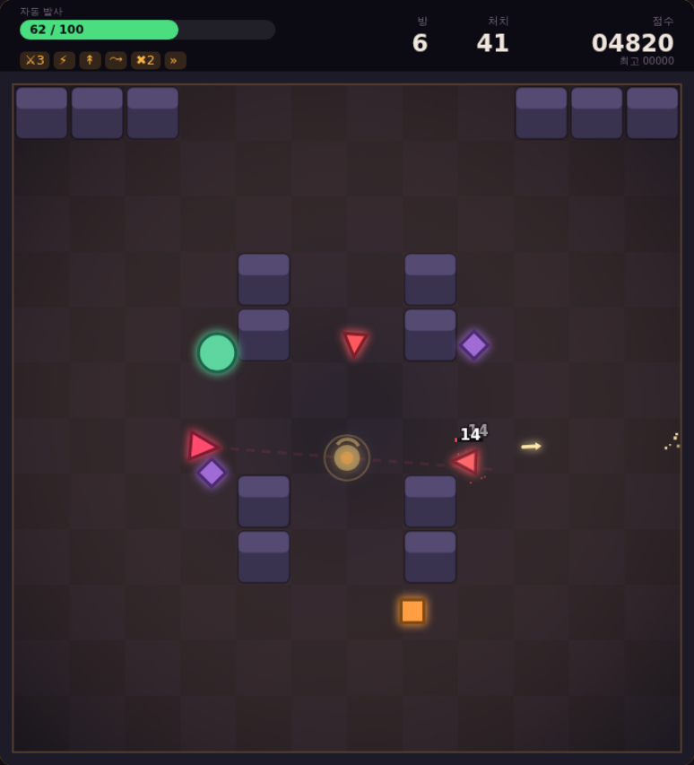
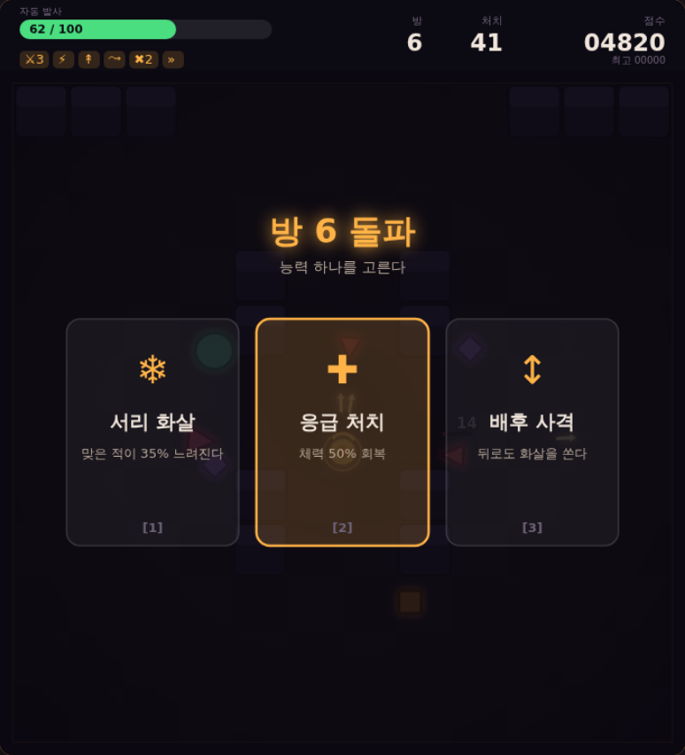

# game_shy_ — ARROWFALL

방을 하나씩 돌파하며 능력을 쌓는 탑다운 로그라이트.
의존성 없는 캔버스 게임이라 빌드 도구도, 외부 라이브러리도, 에셋 파일도 없다.
`index.html` 을 브라우저로 열면 바로 실행된다.



## 실행

```bash
open index.html     # macOS  (Windows: start / Linux: xdg-open)
npm start           # 또는 로컬 서버 — http://localhost:8080
```

## 조작

타이틀에서 두 가지 조작 방식 중 하나를 고른다.

| | 자동 발사 | 수동 조준 |
| --- | --- | --- |
| 발사 | **멈추면** 자동으로 가장 가까운 적을 쏜다 | 마우스로 조준하고 눌러서 쏜다 |
| 이동 중 | 쏘지 못한다 | 쏠 수 있다 |
| 보정 | 피해 **+15%** | 없음 |

멈춰야 쏘는 쪽이 더 위험하므로 그만큼 피해를 얹었다. "피할 것인가 쏠 것인가"의
긴장이 자동 발사 모드의 핵심이다.

| 동작 | 키 |
| --- | --- |
| 이동 | `WASD` · `←↑↓→` · 왼쪽 가상 스틱(터치) |
| 조준·발사 | 마우스 · `Space` · 오른쪽 가상 스틱(터치) |
| 능력 선택 | `1` `2` `3` · 카드 클릭 |
| 일시정지 | `P` · `Esc` |
| 음소거 | `M` |

모바일은 화면을 좌우로 나눠 가상 스틱 두 개가 생긴다.
왼쪽이 이동, 오른쪽이 조준이다. 자동 발사 모드에서는 왼쪽만 있으면 된다.

## 규칙

- 방의 적을 전멸시키면 **능력 3개 중 1개**를 골라 강해지고 다음 방으로 간다.
- **5방마다 보스**가 나온다. 보스를 잡으면 최대 체력의 30% 를 회복한다.
- 체력은 방을 넘어가도 회복되지 않는다. 회복 수단은 능력뿐이다.
- 방이 진행될수록 적의 체력·피해와 수가 늘고, 등장하는 종류도 늘어난다.

## 적

| 이름 | 행동 |
| --- | --- |
| 돌격병 | 곧장 달려들어 부딪친다 |
| 사수 | 거리를 두고 조준 사격한다 |
| 선회자 | 주위를 돌며 3방향으로 흩뿌린다 |
| 돌진병 | 조준선을 그리며 힘을 모았다가 돌진한다 |
| 분열체 | 느리지만 죽으면 조각 2개로 갈라진다 |
| 수호자 | 보스. 전방위 탄막 · 부하 소환 · 조준 3연사를 번갈아 쓴다 |

원거리 적은 엄폐물 뒤에 숨지 않는다. 플레이어가 일정 시간 보이지 않으면
사거리를 버리고 보일 때까지 다가온다. 그러지 않으면 서로 아무것도 못 하는
교착이 되어 방이 끝나지 않는다.



## 능력 16종

공격력 · 공격 속도 · 다중 사격 · 관통 · 도탄 · 추적 화살 · 배후 사격 · 측면 사격 ·
이동 속도 · 최대 체력 · 응급 처치 · 흡혈 · 급소 · 서리 화살 · 큰 화살 · 강타

중첩 상한이 있는 능력은 상한에 닿으면 선택지에서 빠진다.
`응급 처치` 는 체력이 깎였을 때만 후보가 된다.

## 구조

```
index.html          캔버스 한 장과 스크립트 로드
css/style.css       캔버스를 화면에 맞추는 레이아웃만
js/util.js          수학 · 원-사각형 충돌 · 가중치 뽑기
js/audio.js         WebAudio 로 즉석 합성하는 효과음 (에셋 없음)
js/input.js         키보드 / 마우스 / 멀티터치 가상 스틱
js/particles.js     고정 크기 풀을 돌려 쓰는 파티클 + 데미지 숫자
js/content.js       상수 · 적 정의 · 능력 목록 · 방 배치  ← 튜닝은 여기서
js/entities.js      플레이어 · 투사체 · 적 AI
js/game.js          상태 기계 · 방 진행 · 길찾기 · 렌더링
js/main.js          부팅 + 고정 스텝 루프
test/               데이터 검증 + 브라우저 스모크/스트레스 테스트
tools/              파일 한 장으로 묶는 빌드 스크립트
```

ES 모듈 대신 전역 `AF` 네임스페이스를 쓴다. `file://` 로 열었을 때 CORS 에
막히지 않게 하기 위한 선택이다.

물리는 화면 주사율과 무관하게 항상 1/60초 고정 스텝으로 돈다.
120Hz 모니터에서 적이 두 배로 빨라지지 않는다.

### 길찾기

적은 12x12 격자 위에서 **너비 우선 탐색으로 만든 거리장**을 따라 움직인다.
플레이어가 보이면 그냥 직진하고(격자를 따라가면 움직임이 각져 보인다),
보이지 않을 때만 거리장을 따른다.

앞을 조금 짚어 보고 좌우로 트는 국소 조향으로 먼저 만들었다가 버렸다.
폭이 넓은 벽 앞에서 적이 벽을 밀며 멈춰 버려 방이 끝나지 않았다.
격자가 144칸뿐이라 매번 새로 구해도 부담이 없다.

## 방 배치 추가하기

`js/content.js` 의 `ROOMS` 배열에 항목을 더한다.
**한 줄이 정확히 12글자, 12줄**이어야 하고 `#` 이 엄폐물, `.` 이 빈 바닥이다.
아래 두 줄은 플레이어가 등장하는 자리라 비워 둔다.

```js
[ '............',
  '..##....##..',
  '............',
  /* ... 12줄 ... */
  '............' ]
```

고쳤으면 검증부터 돌린다. 줄 길이가 어긋나거나 모르는 글자가 있으면 잡아 준다.

```bash
npm test
```

## 테스트

```bash
npm test              # 데이터 검증 — 의존성 없음
npm i                 # 브라우저 테스트용 playwright 설치
npm run test:browser  # 정상 경로 27개 항목
npm run test:stress   # 경계 / 장시간 / 극단 빌드 23개 항목
```

`test/content.test.js` 는 손으로 적는 데이터를 본다 — 방 배치 문법, 엄폐물 비율,
능력 id 중복과 상한, 모든 능력을 상한까지 쌓았을 때 스탯이 망가지지 않는지,
보스 주기와 난이도 곡선.

`test/smoke.js` 는 정상 경로를 본다 — 조작 모드 전환, **자동 발사가 멈췄을 때만
나가는지**, 수동 조준이 이동 중에도 나가는지, 방 클리어 → 능력 선택 → 다음 방,
보스 등장, 사망, 최고 점수 저장.

`test/stress.js` 는 경계를 노린다 — 적 7종 동시 투입, 능력 16종 최대 중첩,
능력 풀 고갈, 20방 연속 진행, 막힌 방에서의 등장 좌표, 도탄 최대에서 화살이
전장을 벗어나지 않는지, 무작위 상태 전이, 뷰포트별 포인터 좌표 정합.
그리고 **실제로 있었던 결함의 회귀 테스트** — 벽 뒤에서 출발한 적이 반드시
플레이어에게 도달하는지, 시야가 막혀도 방이 끝나는지.

시스템에 설치된 다른 크로미움을 쓰려면 `PW_CHROME=/path/to/chrome` 으로 지정한다.

## 파일 한 장으로 묶기

```bash
node tools/build-artifact.js               # dist/arrowfall.html (감싸기용 조각)
node tools/build-artifact.js --standalone  # dist/arrowfall-standalone.html (그냥 열면 됨)
```

`index.html` 이 참조하는 CSS/JS 를 적힌 순서대로 인라인한다.
스크립트 태그 순서가 곧 의존 순서이므로, 파일을 추가하면 `index.html` 에만
반영하면 빌드가 따라온다.
